<p align="center">
  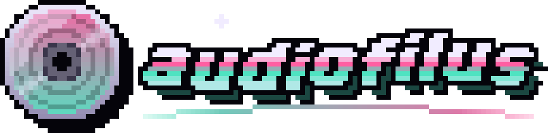
</p>

<p align="center">
  <b>A pixel-art music player for Linux handhelds.</b><br>
  The music keeps playing while you game, and sleep mode turns the screen off so you can control it from your pocket.
</p>

<p align="center">
  <a href="https://juanvillacortac.github.io/audiofilus/">Website</a> ·
  <a href="https://github.com/juanvillacortac/audiofilus/releases/latest">Download</a> ·
  <a href="docs/README.md">Docs</a> ·
  <a href="https://ko-fi.com/juanvillacortac">Support on Ko-fi</a>
</p>

<p align="center">
  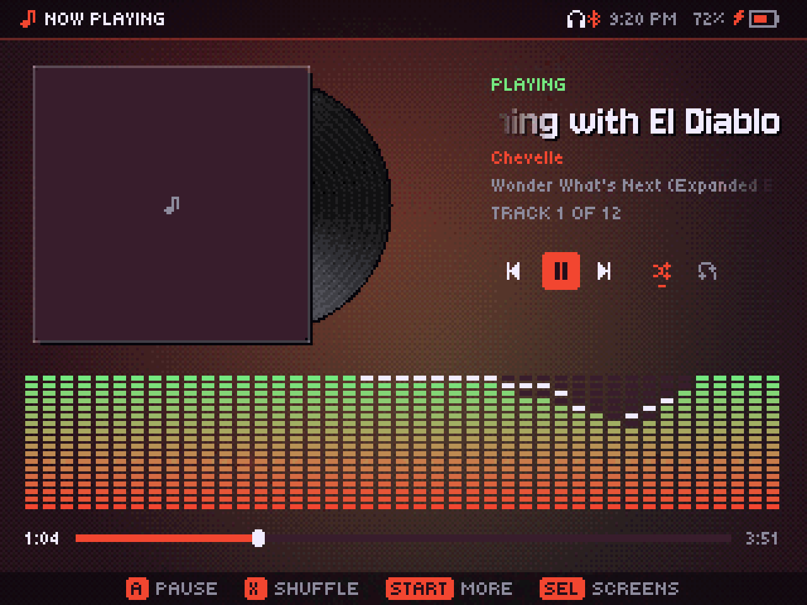
  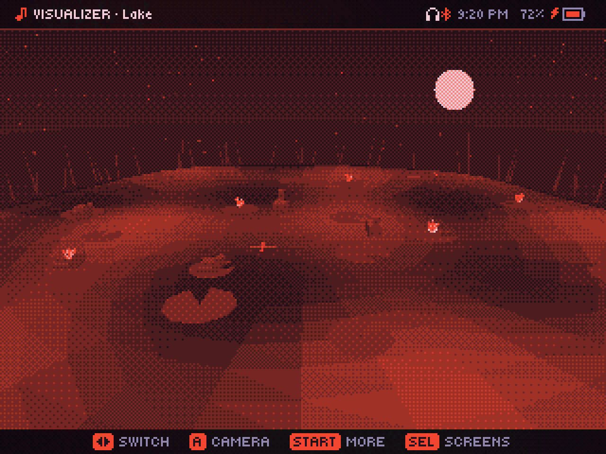
</p>

Runs on **Knulli, muOS, ROCKNIX, ArkOS and dArkOS** through PortMaster (tested on an Anbernic RG34XX-SP), and on **Linux and Windows** desktops.

## Features

### Background play

- **The audio lives in its own service.** The interface is only a remote: close it, open an emulator, and the music keeps going.
- **Controls from inside any game:** hold `FN` and press a button to pause, skip, go back or seek.
- **Headphone buttons**, Bluetooth or wired: one press pauses, two skip, three go back. Devices are watched with inotify, so waiting for them costs no CPU.
- **Sleep mode:** double `START` or the power button turns the screen off, lowers the CPU clock and turns the triggers into gestures. A closed lid keeps it asleep. On an RG34XX-SP it draws about 260 mA: around 11 to 12 hours of music on its 3300 mAh battery (see [docs/power.md](docs/power.md)).
- Gapless playback, fade on pause, shuffle, repeat, "play next" and a queue that survives restarts.
- Volume stays in sync with the system, including boost above 100%.

### Library

- Formats: **MP3, AAC/M4A, ALAC, FLAC, Ogg Vorbis, Opus, WAV, AIFF** and tracker modules (**MOD, XM, IT, S3M**).
- Songs, albums (cover grid), artists, folders and playlists (`.m3u` in your music folder plus your own, saved as `.m3u8`).
- Search across the library, with an on-screen QWERTY keyboard.
- The scan runs once and is cached; later runs only read new or changed files.
- The interface colors come from the album cover.

<p align="center">
  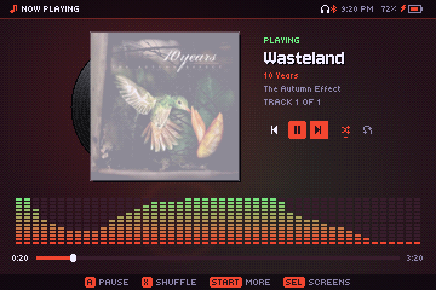
</p>

<p align="center">
  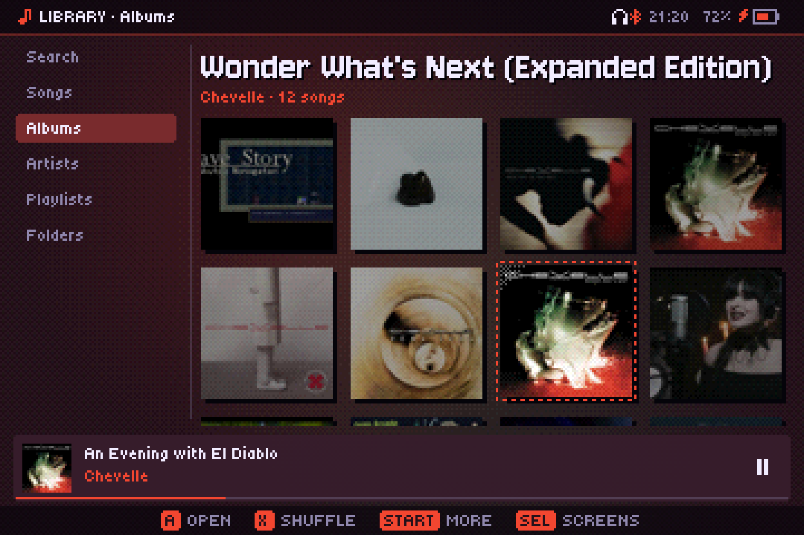
  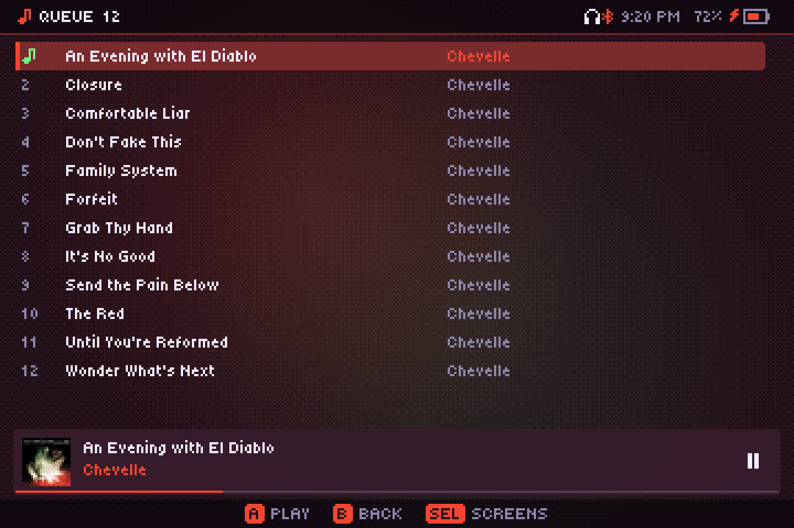
</p>

### Remote sources

| Source | What you get |
|---|---|
| **Subsonic / OpenSubsonic** (Navidrome and others) | Browse, stream, cache and download |
| **Jellyfin** | Same, with your Jellyfin user and its playlists |
| **Internet radio** | Stations from radio-browser.info by country or genre, with the live song title (ICY) |
| **Podcasts** | Top shows for your country, search, any RSS feed; downloads and resume |
| **YouTube Music** | Search without signing in; listen without downloading, or save songs with cover and tags. Requires your own `yt-dlp` (see below) |

Remote songs are cached on the SD card (400 MB by default, least recently used goes first) and the next track is fetched ahead of time.

<p align="center">
  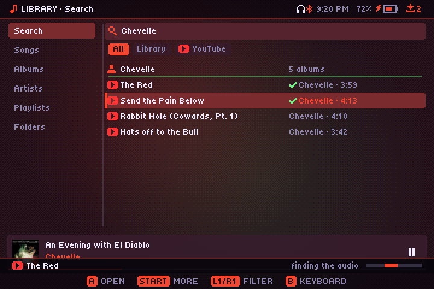
  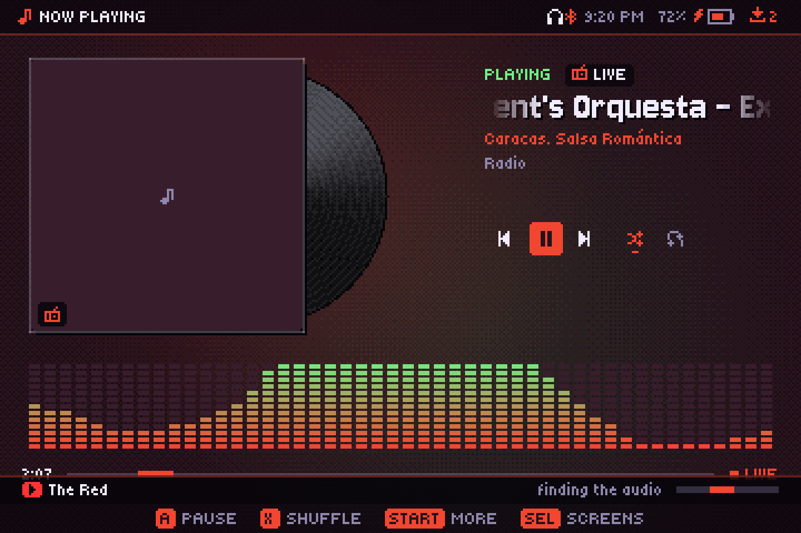
</p>

### Visualizers and games

Eight visualizers that follow the beat: **Lake, Drift, Trench, Plasma, Tunnel, Waves, Bars and Ridges** (stacked spectrum lines, like the *Unknown Pleasures* cover). Plus eight arcade games and a tracker, together under **Games** in the screens dock (and a few secrets hidden around the app):

- **Crypt**: a rhythm roguelike. Step, fight and dive deeper through random dungeons, but only on the beat of the song that's playing; enemies move to it too. On-beat streaks raise a multiplier up to FEVER ×4.
- **Blocks**: falling blocks, with hard drops on the beat for combos.
- **Rhythm**: notes generated from the song that's playing.
- **Runner**: like Chrome's offline dinosaur, but on the beat. Speakers arrive on the kick and flying vinyls on the snare; hold to jump higher, duck under the records, and jump on the "and" for a PERFECT. One hit and it's over.
- **Name that song**: a few seconds of a song from your library, four choices, ten rounds.
- **Snake**: steps on the song's beat subdivisions, so every song plays at its own speed.
- **Ships**: a shooter that fires on every eighth note and spreads on the bass.
- **Duel**: turn-based battles to the beat. Strike near the center of the bar, which lands right on the beat, then dodge the notes a scratched vinyl, a tangled tape and a metronome throw at you: they surge on every beat, and the song's snares and cymbals send more.
- **Tracker**: make chiptune with the D-pad, Game Boy style: two pulse channels, a triangle and noise, 16-step patterns with arpeggio, duty and pitch-bend effects, and a song order. Several songs, four examples to start from, and WAV export straight into your library.

<p align="center">
  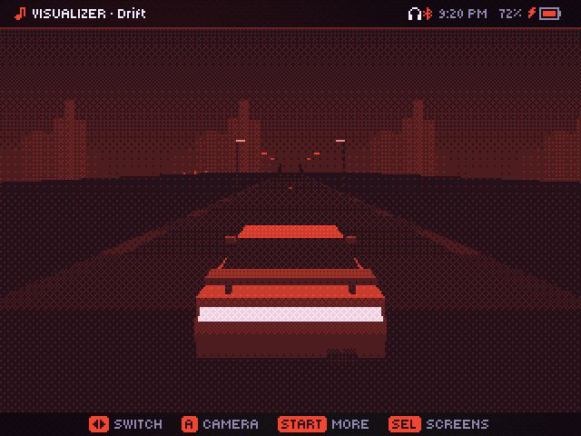
  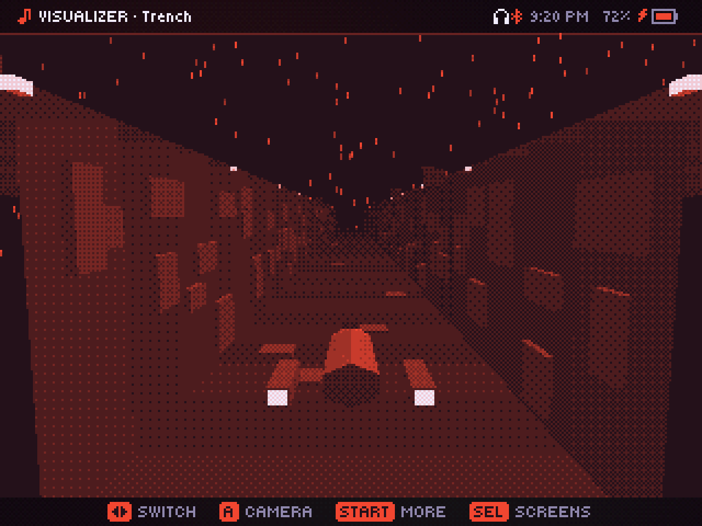
  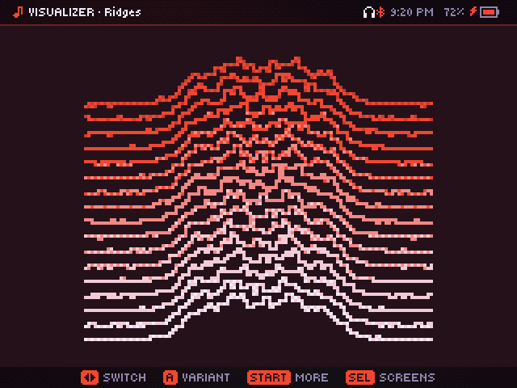
</p>
<p align="center">
  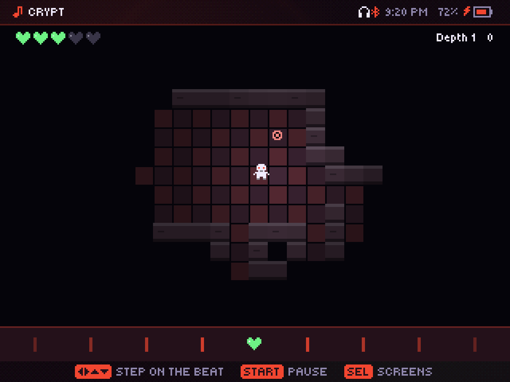
  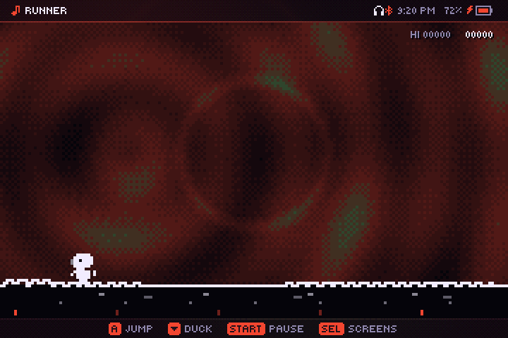
  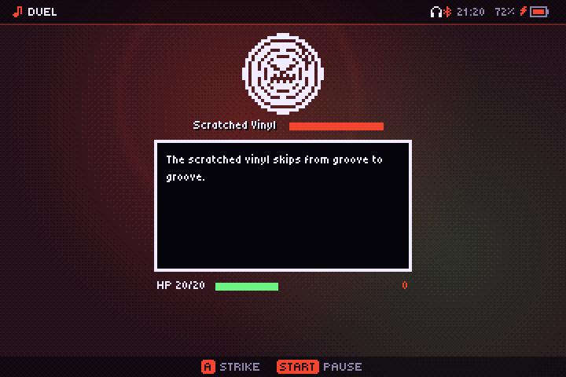
</p>
<p align="center">
  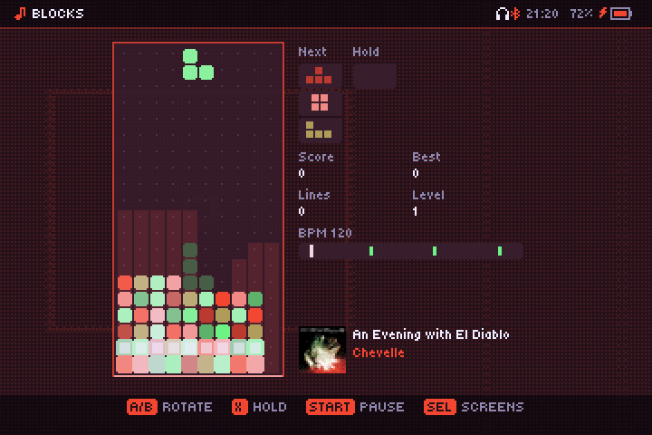
  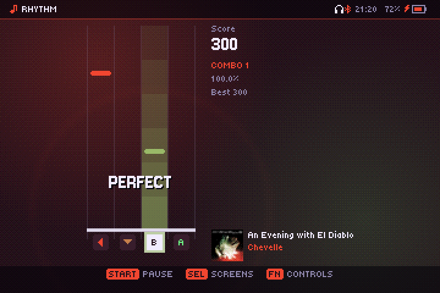
  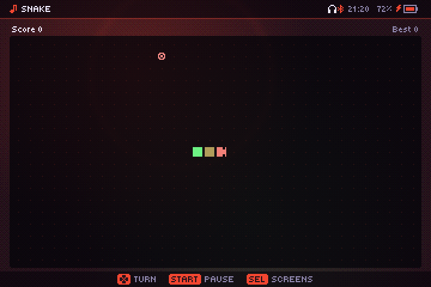
</p>

### Interface

- `SELECT` opens a dock with every screen; double `SELECT` returns to the previous one. `START` opens the More menu.
- Hold `FN` on any screen to see its controls.
- The left analog stick works like the D-pad everywhere, menus and games included.
- On Now Playing, `↑`/`↓` scratch the vinyl, and the song itself scratches back and forth like a record under your hand.
- The layout follows the screen's real shape: any width from 1:1 to 21:9 in landscape, and portrait (phone-like, down to 9:21) with its own Now Playing layout.
- Optional chiptune sounds, with separate switches for menus and for music actions. Game sounds are low thumps and soft hits, made to sit under any music, metal included.
- English and Spanish, 12 h (AM/PM) or 24 h clock.
- On desktop: fullscreen with sharp pixels.

<p align="center">
  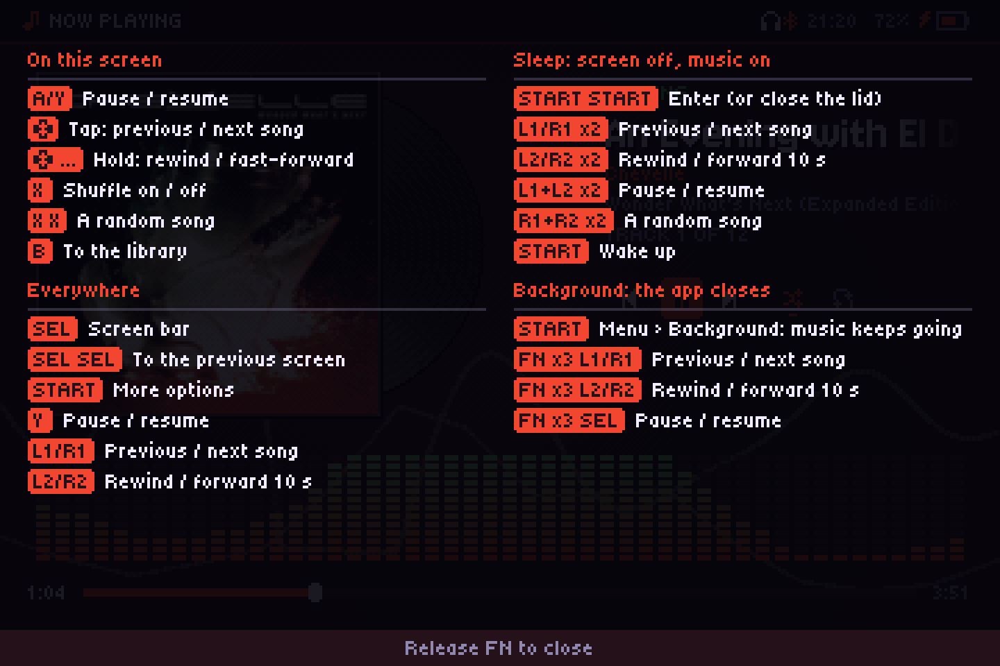
  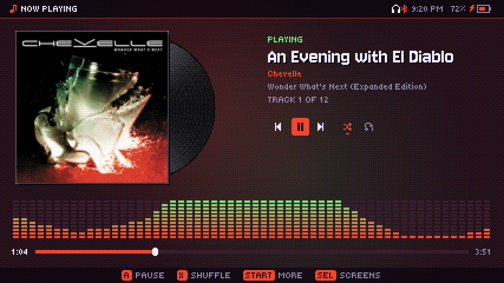
</p>

### Linux desktop

On a Linux PC it fits in like a native app, on GNOME, KDE, Hyprland or [Omarchy](https://omarchy.org):

- **App launcher:** Audiofilus shows up with its icon, with Play/Pause, Next and Previous actions.
- **Window:** its class is `audiofilus`, so docks group it and window rules can target it.
- **Media keys and bars:** it speaks MPRIS, so keyboard media keys, headphone buttons and the desktop's media widget control it, with cover and title. On Omarchy that works with nothing to set up.
- **System tray** (also on Windows): the audiofilus CD sits in the tray while the music plays in the background: click to open the player, middle click to pause, and a menu with what's playing, play/pause, next, previous, shuffle and quit.
- **Closing the window keeps the music playing** (a setting, on by default on the desktop); Quit stops everything.

Details in [docs/linux-desktop.md](docs/linux-desktop.md).

## Install

### Handhelds (PortMaster)

1. Download `audiofilus-portmaster.zip` from the [latest release](https://github.com/juanvillacortac/audiofilus/releases/latest).
2. Install it with PortMaster, or unzip it into your `ports` folder.
3. Open **audiofilus** from Ports and pick your music folder.

Settings (`audiofilus.json`) and state (`data/`) live next to the binary.

**YouTube Music** shows up only if there is a `yt-dlp` binary in the app's `yt-dlp/` folder (or on `PATH`). audiofilus doesn't ship or download it; get the `yt-dlp_linux_aarch64` build from the [yt-dlp releases](https://github.com/yt-dlp/yt-dlp/releases) for handhelds. Songs that need a signed-in account (age-restricted) are played from another upload of the same song when there is one. If YouTube asks your network to confirm it's not a bot, or you want signed-in access, put a `cookies.txt` exported from your browser in that `yt-dlp/` folder ([how](https://github.com/yt-dlp/yt-dlp/wiki/Extractors#exporting-youtube-cookies)).

### Linux desktop

```sh
curl -fsSL https://juanvillacortac.github.io/audiofilus/install.sh | sh
```

It downloads the latest release for x86_64 or aarch64 into `~/.local/share/audiofilus`, links `audiofilus` into `~/.local/bin`, and adds Audiofilus to the app launcher. Run it again to update; settings are kept. To uninstall:

```sh
audiofilus quit; audiofilus desktop uninstall
rm -rf ~/.local/share/audiofilus ~/.local/bin/audiofilus
```

Or by hand: grab `audiofilus-linux-amd64.tar.gz` (or `-arm64`), unzip it anywhere, run `./audiofilus desktop install` once and open it from the launcher.

### Windows

On Windows 10 or later, grab `audiofilus-windows-amd64.zip`, unzip it anywhere and run `audiofilus.exe`. MP3, FLAC, Ogg Vorbis, ALAC, WAV and AIFF play out of the box. For AAC/M4A, Opus and tracker modules, put the MSYS2 DLLs next to the `.exe` (`libfdk-aac-2.dll`, `libopusfile-0.dll` with `libopus-0.dll` and `libogg-0.dll`, `libmpg123-0.dll`, `libxmp-4.dll`). For YouTube Music, put `yt-dlp.exe` in a `yt-dlp` folder next to it, and `ffmpeg.exe` on `PATH` to convert downloads to MP3.

## Build

With Docker, nothing else needed:

```sh
docker build --target dist --output dist .
```

Or with Go (see `go.mod` for the version; the desktop build needs the X11, OpenGL and ALSA headers, e.g. `libgl1-mesa-dev xorg-dev libasound2-dev`):

```sh
./build.sh
```

Both leave in `dist/`:

| File | What it is |
|---|---|
| `audiofilus-amd64`, `audiofilus-arm64` | Everything in one binary: the player (run it with no arguments), the audio service (`audiofilus daemon`, which the player starts itself) and the CLI |
| `audiofilus-windows-amd64.exe` | The same for Windows |
| `audiofilus.zip` | The PortMaster port |

The handheld builds use no cgo. SDL2, mpg123, fdk-aac, opusfile and libxmp are loaded at runtime with [purego](https://github.com/ebitengine/purego) when the system has them. The interface uses [a fork of Ebitengine](https://github.com/juanvillacortac/ebiten) with an SDL2 backend.

### CLI

```sh
dist/audiofilus play ~/Music          # starts the service and plays
dist/audiofilus status
dist/audiofilus next | prev | toggle | seek +30 | shuffle on | repeat all
dist/audiofilus quit
```

### Tests

```sh
go vet ./... && go test ./...
```

Releases are built by GitHub Actions when a `v*` tag is pushed.

## Roadmap

- **Handhelds:** an OpenGL ES 2.0 path for devices without GLES 3 (for now it needs OpenGL ES 3.2).
- **Desktop:** mouse controls, Windows system media controls, window-sized layouts.
- **Android** and **iOS**: touch controls and system media controls.

## Support

audiofilus is free and made in my spare time. If you enjoy it, you can buy me a coffee:

<a href="https://ko-fi.com/juanvillacortac"></a>

## License

[MIT](LICENSE). The bundled fonts, Jersey 10 and Tiny5, are under the SIL Open Font License (`internal/ui/assets/fonts/OFL-*.txt`).

## Docs

How it works, platform details and power measurements are in [docs/](docs/README.md).
